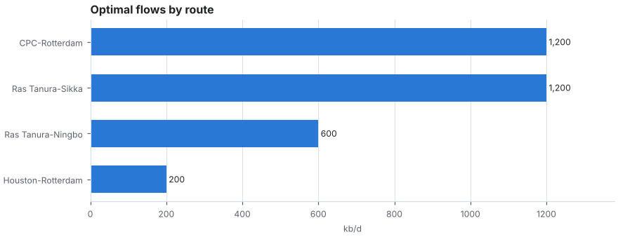
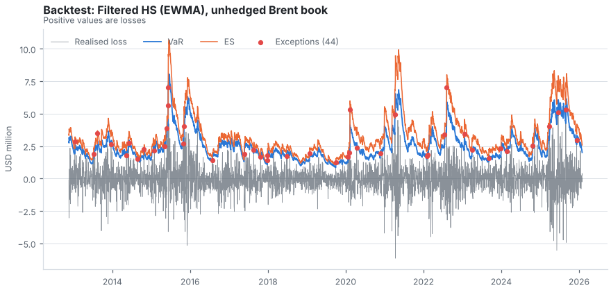

# Commodity Merchant Digital Twin

[](https://github.com/temirlankakzhanov/commodity-twin/actions/workflows/ci.yml)


A small, honest model of a physical crude-oil trading desk, built around three questions:

1. **Where should the barrels go?** A linear programme chooses margin-maximising flows over a
   route network, subject to supply, demand and chokepoint capacity.
2. **What breaks when a chokepoint closes?** Stress scenarios (Red Sea, Hormuz, Panama, price
   crash) and a traffic monitor built on IMF PortWatch data feed back into the optimiser.
3. **Can the risk numbers be trusted?** An independent validation lab backtests five VaR/ES
   models with Kupiec, Christoffersen, Basel traffic-light and Acerbi-Szekely tests and writes a
   bank-style validation memo.

**Live demo:** _add your deployed URL here_ &nbsp;|&nbsp; **Methodology:** [docs/methodology.md](docs/methodology.md)



> Figures in this README are rendered from **synthetic** data so they are reproducible
> (`make figures`). The live app shows real FRED and IMF PortWatch data whenever the APIs are
> reachable, and says clearly when it is not.

## Why this project

Merchants such as Trafigura or Cargill earn margin on logistics and optionality, and lose it on
disruptions and on risk models nobody challenged. This repository connects those worlds: the
same price history drives the trade economics and the VaR backtests.

| Module | What it does | Key techniques |
| --- | --- | --- |
| `mtwin.data` | Fetches FRED, World Bank, IMF PortWatch (optional Yahoo) | Retries with back-off, TTL cache (Parquet or csv.gz), DuckDB catalogue, 5-step fallback chain |
| `mtwin.trading` | Route economics, flow optimiser, scenarios, book exposures, margin-at-risk | `scipy.optimize.linprog` (HiGHS), LP shadow prices, bootstrap Monte Carlo |
| `mtwin.risk` | VaR/ES forecasting and backtesting | Historical, normal, EWMA, filtered HS (EWMA, GARCH(1,1)); Kupiec, Christoffersen, Basel, ES Z2 |
| `mtwin.signals` | Chokepoint traffic monitor | 7-day average vs lagged 180-day baseline, percent change and z-score flag |
| `mtwin.ui` | Streamlit app | Six tabs, downloadable validation memo |

## Quick start

```bash
git clone https://github.com/temirlankakzhanov/commodity-twin.git && cd commodity-twin
make install          # creates .venv, installs dependencies, sets up pre-commit
make fetch            # optional: downloads real data into .cache/ (needs internet)
make run              # http://localhost:8501
make check            # ruff + pytest, the same as CI
```

No API key is needed. For a higher FRED rate limit, copy `.env.example` to `.env` and set
`FRED_API_KEY` (free). Without any network the app runs on clearly labelled synthetic data.

## Data sources and licences

**FRED / U.S. Energy Information Administration**

- *Used for:* Brent, WTI and Henry Hub daily spot prices (FRED series `DCOILBRENTEU`,
  `DCOILWTICO`, `DHHNGSP`), via the public CSV endpoint or the official API with a key.
- *Citation:* U.S. Energy Information Administration, retrieved from FRED, Federal Reserve Bank
  of St. Louis.
- *Terms:* labelled on [FRED](https://fred.stlouisfed.org) as "Public Domain: Citation
  Requested".

**IMF PortWatch**

- *Used for:* daily transit calls through maritime chokepoints
  ([IMF PortWatch](https://portwatch.imf.org)).
- *Citation:* UN Global Platform; IMF PortWatch.
- *Terms:* used with attribution to the IMF as the source, under the
  [IMF copyright and terms of use](https://www.imf.org/en/About/copyright-and-terms). A separate
  licence specific to PortWatch has not been confirmed; this is a non-commercial educational
  project.

**World Bank**

- *Used for:* GDP (`NY.GDP.MKTP.CD`) and trade as a share of GDP (`NE.TRD.GNFS.ZS`), annual, via
  the [World Bank API](https://datahelpdesk.worldbank.org/knowledgebase/topics/125589).
- *Citation:* The World Bank: World Development Indicators.
- *Terms:* CC BY 4.0 by default, see the
  [World Bank summary terms of use](https://data.worldbank.org/summary-terms-of-use).

**Yahoo Finance (off by default)**

- *Used for:* optional price source via `yfinance`.
- *Terms:* Yahoo's terms limit use to personal use. Do not enable it on a public deployment.

Committed snapshots in `data/snapshots/` should only be created from sources whose licence
allows redistribution.

Data in this project is for educational purposes only and is not investment advice.

## Reliability design

Every dataset is resolved through the same chain and the UI reports which step served it:

```
fresh cache -> live API -> stale cache -> committed snapshot -> synthetic data
```

Free hosting has an **ephemeral disk**, so the cache does not survive a restart. Run
`make snapshot` once and commit `data/snapshots/` so a cold start still shows real data when the
APIs are down. Provider failures start a cooldown so a broken API is not hammered on every
rerun, and error messages never contain query strings (so API keys cannot leak into logs).

## Validation lab in one picture



A full example is in [docs/sample_validation_memo.md](docs/sample_validation_memo.md) (synthetic data). The lab reports exceptions against the expected count, three p-values, the Basel zone on the
last 250 days and the ES Z2 statistic, then applies a transparent verdict rule
(PASS / REVIEW / FAIL). The validation memo can be downloaded as Markdown.

## Project layout

```
mtwin/
  config.py            environment-driven settings
  data/                http, cache, providers, service (fallback chain), synthetic data, catalogue
  risk/                returns, volatility, var_models, backtest, validation
  trading/             network, optimizer, scenarios, book
  signals/             chokepoint monitor
  ui/                  charts (matplotlib), compute (framework-free), pages (Streamlit)
streamlit_app.py       entry point
scripts/               fetch_data.py, make_readme_figures.py
tests/                 pytest suite (offline, deterministic)
docs/                  methodology and figures
```

Dependencies point one way: `ui -> risk / trading / signals -> data`. Nothing below `ui`
imports Streamlit, so every calculation is unit-testable.

## Testing

```bash
make test             # offline and deterministic; the live APIs are never called
```

The suite covers the maths against hand calculations (Kupiec, shadow prices checked by finite
differences, GARCH parameter recovery, no-look-ahead checks), the data layer (TTL, corruption,
cooldown, fallback order, a real HTTP server returning 503 twice to prove the retries) and the
UI (page code against a stand-in, plus Streamlit's `AppTest` when Streamlit is installed).

## Deployment

See the deployment section of the project guide. Short version for Streamlit Community Cloud:
push to a public GitHub repo, choose `streamlit_app.py` as the entry point, select Python 3.12 in
the advanced settings. A Dockerfile is included for Render or Hugging Face Spaces (Docker SDK).

## Limitations

- The trade network (ports, volumes, freight, differentials, chokepoint capacities) is an
  **illustrative assumption**, not market data. Replace `default_network()` to model a real desk.
- The optimiser is single-period and deterministic; it has no storage, timing or credit.
- Margin-at-risk includes an assumed basis volatility (0.5 USD/bbl), which needs desk data.
- Backtests at 99 % confidence have low statistical power on a single series.
- GARCH parameters are estimated once on the first 750 days and then frozen.
- The chokepoint flag clears after a long disruption because the baseline adapts.
- Not investment advice.

## Roadmap

Multi-period optimisation with storage and contango, product slate (crude, gasoil, LNG),
Expected Shortfall backtests with simulated p-values, a vessel-level AIS layer, and credit-risk
limits per counterparty.

## License

MIT. See [LICENSE](LICENSE).
